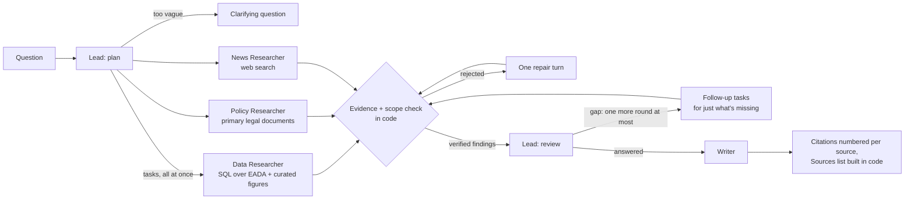

# Title IX Deep Research Agent

Live at: https://title-ix-deep-research-agent.cloud.run/ 

In another lifetime, I was a college athlete. My freshman year was the first year that NIL earnings (Name, Image, and Likeness) became a thing, and it quickly became clear that despite Title IX (the federal ruling to prevent sex-based discrimination in sport), in reality things were the wild west (alas, writing this, I am not a millionaire). I wanted to build this agent to better understand revenue trends, existing gaps, recent policy updates, and what can and can't be answered with available data. Unfortunately, a lot of the total financial picture is hidden behind NIL payments that are harder to track publicly, and existing loopholes allow schools to avoid full transparency. 

Ask the research agent about participation, spending and revenue at a school, conference or division, or how revenue sharing and NIL are changing them. It answers from the federal Equity in Athletics (EADA) filings, primary legal documents (Title IX regulations, the House v. NCAA settlement, NIL Go rules) and recent news, and every number in the answer is checked against the query result or text it came from before you see it.

## Sample queries

Its edge is questions answered by a **calculation over the federal filings**: a share of schools,
a trend, a statistical test. No article has published those numbers. Without tools, the model doesn't
have them; with search, it substitutes a nearby figure, such as an NCAA rule, another report or another
definition, with no source you can check. Each question below went to three systems:
- **this agent**;
- **Gemini 3.5 Flash with no tools and no system prompt**, the same model the agent's Lead and Writer use;
- **the same model with Google Search**.

The expected answers are computed by SQL from the EADA tables named below. The last two questions
were held out from all tuning.

| Question | Expected (source) | This agent | Gemini, no tools | Gemini + Search |
|---|---|---|---|---|
| Is there a difference between coaching staff sizes between men's and women's college basketball? If so, is that difference statistically significant? | 5.24 vs. 4.87 coaches per team, D-I 2024-25; significant (t ≈ 7.8). Table `sports` ⨝ `institutions` | 5.24 vs. 4.85, significant (t = 7.9) | "No statistically significant difference" | "No difference" (NCAA limits are equal) |
| In 2024-25, what share of SEC schools spent at least 25% of their team expenses on women's teams? | 62.5% (10 of 16). View `v_spending_by_gender` ⨝ `conferences` | 62.5%, naming each school | "Not yet available" | **100%** |
| How did average total expenses per team for Division I women's volleyball change from 2018-19 to 2024-25? | +29.9% ($1.06M → $1.38M). Table `sports` ⨝ `institutions` | +29.9%, with a yearly chart | "An estimated 35% to 60%" | **+72%** |

Ask them in the live app or with `POST /chat {"message": "..."}`. The full answers from all three
systems, the SQL behind each expected value, and the sources are in
[`docs/examples.md`](docs/examples.md). Every number the agent gives links to its evidence and SQL.

On broad questions ("how do schools without big football programs compete?") the agent and Gemini +
Search cover similar ground, but only the agent cites each claim. The end-to-end evals went from 11/19
to 16/19 with the query-scope check below, and from 5/8 to 7/8 on held-out questions. Data questions
take 20–60 seconds; broad ones take 1.5–2.5 minutes.

## Data

| Source | What | Loaded as |
|---|---|---|
| [EADA data files](https://ope.ed.gov/athletics/#/datafile/list), U.S. Dept. of Education | Participation, enrollment, coaching, spending and revenue by school, sport, gender and year; 2015-16 through 2024-25, 2,203 schools | `institutions` (20,353 school-years), `sports` (173,686 sponsored-sport rows), views `v_proportionality`, `v_spending_by_gender` |
| IPEDS institutional characteristics | Each school's conference by year, a power-conference flag | `conferences` |
| [`data/nil_facts.csv`](data/nil_facts.csv) | 13 curated NIL, revenue-sharing and settlement figures, each with its source, period, method note and whether it was checked against the primary source | `nil_facts` |
| [`data/policy/`](data/policy/) | 14 primary documents: Title IX statute and regulations, the 1979 interpretation and 1996 three-part test clarification, OCR NIL guidance and its rescission, the House v. NCAA settlement and final approval order, CSC / NIL Go rules, the EADA user's guide | searched by `policy.py` |
| Web (Tavily) | Recent news and reports | `web.py`, cached 24 h with retrieval time |

Column meanings, known pitfalls and the build decisions to clean and aggregate everything are logged in a fresh markdown in [`data/README.md`](data/README.md) and
[`data/column_notes.json`](data/column_notes.json).

## How it works



1. **Lead** gives each researcher with part of the answer a task. They run in parallel, each in a fresh
   context. It asks a clarifying question only when no sensible default exists. A **broad**
   question (how something is playing out across schools) gets two news angles, a bigger search
   budget and a longer answer.
2. **Researchers:** *Data* writes SQL over EADA (2015-16 to 2024-25, 2,203 schools) and curated NIL
   figures. *Policy* searches 14 primary legal documents. *News* searches the web (Tavily), with no
   paywall workarounds.
3. **Evidence check** (plain code):
   - every quote must be in what a tool returned this run;
   - every number must be in that quote or query result;
   - every query must filter on the task's scope (sport, conference, division, years, schools), which
     a model extracts in the database's own spellings.

   Rejected findings get one repair turn.
4. **Lead review** sends one more round, at most, for a part of the question that's still unanswered.
5. **Writer** uses only verified findings, never its own knowledge. It keeps the kinds of money apart
   (athletics spending, revenue sharing, NIL, House back-pay), labels every number with its period
   and ends with limits. Hovering a citation shows the evidence and the SQL.

Follow-up questions reuse the conversation's findings. Unanswerable questions (an athlete's NIL
pay, whether a school complies with Title IX) say so. The check can't tell whether a query computed
the right thing within its scope; that's what the gold-answer evals are for.

## Run it

```bash
cp .env.example .env                  # add VERTEXAI_PROJECT and TAVILY_API_KEY
gcloud auth application-default login
uv sync
uv run scripts/build_eada.py          # once, offline (raw files: data/README.md)
uv run app.py                         # http://localhost:8000
```

Deploying to Cloud Run: [`docs/DEPLOY.md`](docs/DEPLOY.md).

## Repo overview

```
app.py              FastAPI: the page, /run (live events), /chat (JSON), conversations
research.py         Lead (plan, review), Data, Policy and News Researchers, Writer; citations and source cards
evidence.py         the evidence check, chart check and citation check (stdlib, self-test)
eada.py             read-only DuckDB, the task-sized schema, the scope vocabulary (sports, conferences, divisions)
policy.py  web.py   policy corpus search; web search, fetch, paywall detection, cache
runlog.py           run traces and the per-agent scorecard
context_panel.py    context-panel.js   the course template's context panel (Film room tab)
static/             the page: index.html, playbook.js (the play diagram)
scripts/            offline: download_eada.py, build_eada.py
sql/                tables.sql (columns kept), views.sql (derived metrics)
data/               column_notes.json, nil_facts.csv, sources.json, policy/ (database and raw files: gitignored)
evals/              plan, scope, data and e2e cases (gold SQL, held-out set); run_evals.py, compare_baseline.py, scoring.py
```
