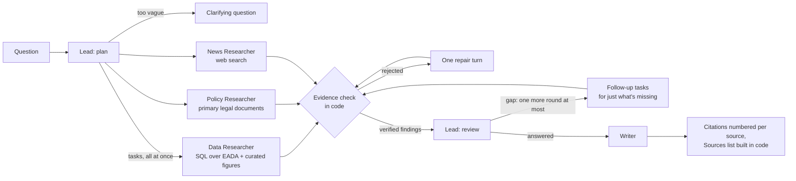

# Title IX Deep Research Agent

A research agent for **gender equity in college athletics**. Ask about participation, spending and
revenue at a school, conference or division, or how revenue sharing and NIL are changing them. It
answers from the federal Equity in Athletics (EADA) filings, primary legal documents (Title IX
regulations, the House v. NCAA settlement, NIL Go rules) and recent news, and every number in the
answer is checked against the query result or text it came from before you see it.

**Who it's for:** student journalists, athletes and recruits, Title IX coordinators, advocates.

Live at: **TODO URL** · Design notes: [`docs/PROJECT_BRIEF.md`](docs/PROJECT_BRIEF.md) ·
Full example answers: [`docs/examples.md`](docs/examples.md)

## How it works



1. **Lead (plan)** reads the question and returns either a clarifying question or a task for every
   researcher that has part of the answer. They're sent at once and run in parallel, each in a fresh
   context that sees only its task.
2. **Data Researcher** writes SQL against a read-only DuckDB copy of EADA (2015-16 through 2024-25,
   2,203 schools) and a curated table of NIL, revenue-sharing and settlement figures. It sees only the
   part of the schema its task needs, plus the notes that prevent known wrong answers.
3. **Policy Researcher** searches 14 primary legal documents (Title IX regulations, the three-part
   test, the House v. NCAA settlement and the court's approval order, NIL Go rules, the EADA guide).
4. **News Researcher** searches and reads the web (Tavily) for what happened after the data and the
   documents. No paywall workarounds.
5. **Evidence check** (`evidence.py`, plain code): a finding survives only if its quote is in what a
   tool returned this run and every number in its claim is in that quote or query result. A researcher
   gets one turn to fix rejected findings; the fixes face the same check.
6. **Lead (review)** sees the verified findings, the gaps the researchers reported and what was
   rejected, and goes back for more when an important part is unanswered: follow-up tasks for just
   that part, naming what was already found. At most one more round (`MAX_ROUNDS = 2`). It stops when
   the findings answer the question or the gap is something no source has.
7. **Writer** sees only the question and the verified findings. It keeps the four kinds of money apart
   (school athletics spending, revenue sharing, third-party NIL, House back-pay damages), labels every
   number with its period, and ends with what the answer can't tell you.
8. **Citations** are numbered per source in reading order ([1], [2]...). On the page, hovering a
   citation shows the source, the exact evidence each claim rests on, and the SQL.

Limits per question, enforced in code: 2 research rounds, 10 turns and 8 SQL queries per researcher,
5 policy searches, 4 web searches. A follow-up question in the same conversation starts from the
findings already gathered instead of researching again.

### Assignment requirements

| Requirement | Where |
|---|---|
| At least three agent shapes with different jobs | Lead (plan and review), three Researchers with different tools (Data, Policy, News), Writer: `research.py` |
| The Lead fans out to several Researchers in one turn; they run in parallel in fresh contexts | `_deep_research`: one `asyncio.gather` per round over the plan's tasks; each researcher's input is only its task. Multi-part questions go to all three (`fan-out`, `house`, `compliance` plan cases) |
| The Lead goes back for more when the findings leave a gap, up to a turn cap | `review()` after each round, `MAX_ROUNDS = 2`; tested by the `review-gap`, `review-done` and `review-unanswerable` cases |
| Vague questions require clarification | the plan's `clarify`; `vague-1`, `vague-2` in the plan and end-to-end evals |
| The output is accurately cited | evidence check before the Writer; citations and the Sources list built in code from what was retrieved; gold numbers checked in the end-to-end eval |

## Examples: this agent vs. Gemini with Google Search

Three questions, each asked of this agent and of Gemini 3.5 Flash (the model the Lead and Writer
use) with Google Search grounding on. Both answers are scored by the same code
([`evals/scoring.py`](evals/scoring.py)) against gold facts computed from the database or quoted from
the court documents. Full answers: [`docs/examples.md`](docs/examples.md).

| Question | Gold answer | This agent | Gemini + Google Search |
|---|---|---|---|
| How did average revenue and total expenses per team for Division I women's basketball change from 2021-22 to 2023-24? | Revenue $1,977,711 → $2,481,325; total expenses $2,919,841 in 2023-24 (EADA, 352 → 356 schools) | **3/3**: all three averages, with a chart, cited to the query | **0/3** (scored 1/3: an unrelated "$2.45 million" fell within the 1.5% tolerance): averages of $3.85M revenue and $4.28M expenses over "362 programs", which don't match EADA |
| Under the House v. NCAA settlement, how much can a school pay its athletes directly in 2025-26, and how much goes to former athletes in back-pay damages? | $20.5M cap (22% of average shared revenue); $2.576B in damages, paid over ten years (final approval order) | **2/2**: both, cited to the curated settlement figures and the court order | **1/2**: the cap, but "$2.78 billion (often rounded to $2.8 billion)" in damages, not the court's $2.576B |
| Is the University of Michigan in compliance with Title IX in athletics? | Can't be determined from public data; proportionality is one prong of the three-part test; Michigan's gap was 7.8 points in 2024-25 | **1/1**: says it can't be determined, explains the three-part test, gives the gap by year (−0.2 in 2015-16 to 7.8 in 2024-25) | **0/1**: a 2026 culture review, complaints and lawsuits; no gap figure, no three-part test |

Neither made a forbidden claim (asserting compliance, mixing up the money flows). The cost is real:
the agent took 35 to 170 s and 35k to 161k tokens per question (the Michigan question sends all three
researchers and, this run, one follow-up); Gemini took 15 to 345 s and 2k to 10k tokens. That's one
run of each per question, and answers vary between runs, so each of these questions is also an
end-to-end eval case below.

## Evaluating each part on its own

Splitting the work into agents is only useful if you can tell which one to fix. Each part has its own
eval, with gold answers computed from the database (the SQL is in the case files), so a failure points
at a part:

| Eval | What it runs | Checks | Last result |
|---|---|---|---|
| `uv run evals/run_evals.py plan` | the Lead alone: 9 planning questions and 4 reviews | plan: clarifies when it should, sends the right researchers; review: goes back for a real gap, stops when answered, unanswerable, or when what's missing is detail the question didn't ask for | **13/13** |
| `uv run evals/run_evals.py data` | the Data Researcher alone, 6 tasks | gold numbers in its verified findings; queries, errors, tokens | **6/6** |
| `uv run evals/run_evals.py e2e` | whole runs, 8 questions | gold numbers in the report, required points, forbidden claims, citations that resolve, a Limits section | final code: **5/5** on the non-README cases, and the 3 README cases passed in the comparison run. Before the review fix: 7/8, every gold number present; the miss was the House answer not saying the cap is 22% of average shared revenue |
| `uv run evals/compare_baseline.py` | the README examples vs. Gemini | the table above | 6/6 gold numbers vs. 1/6 (2/6 scored, one a tolerance false positive) |

Each run also leaves a trace (`uv run runlog.py last`) with a **scorecard per agent**: model calls,
tokens, tool calls, failed calls, refused repeats, findings verified and rejected, and the repair
turn's before and after.

### What the evals caught

| What went wrong | Caught by | Part at fault | Fix |
|---|---|---|---|
| "Division I" averages covered 1,055 teams: `LIKE 'NCAA Division I%'` also matches Divisions II and III | a report's numbers, then `data` eval | Data (schema) | an `ncaa_division` column built from the exact labels, and a note |
| Department-wide recruiting and coach pay reported as basketball figures | the same report | Data (schema) | a note: school-level columns cover all teams |
| One finding per year hit the 8-finding limit, dropping 2023-24 and 2024-25; the report then said EADA "only covers up to 2022-23" | `e2e` Michigan case, then a `data` case for it | Data Researcher, Writer | trends are one finding; code adds back the latest rows of a cited query; the Writer knows the data runs through 2024-25 |
| A sound finding thrown out over one number the model worked out itself ("rose 25.46%") | scorecard rejections | Researchers | one repair turn with the rejection reasons |
| A researcher searched the policy documents 9 times, hit its turn limit and returned nothing | trace | Policy research | a final write-up turn at the limit; 5 policy searches max; plain-word searches |
| Policy findings rejected as "not retrieved": cited by the court PDF's address, or as two passages joined with "..." | scorecard rejections | evidence check | resolve a document address to the retrieved passage; check each part of an ellipsis quote |
| "342 schools in 2024-25" rejected: the year was in the query's WHERE clause, not its rows | `e2e` | evidence check | years the query filtered on count as evidence |
| A numbers question padded with EADA reporting rules nobody asked about | `e2e`, `plan` | Lead, Writer | numbers questions get only the Data Researcher; background only when asked |
| The $1.976B NIL claims fund called the total back-pay damages | `e2e` House case | Writer, data | a curated figure checked against the court order; the Writer told the sub-funds aren't the total |
| Total expenses called "operating expenses" (in EADA that's game-day costs only) | a smoke run | Writer, Data | a note and a Writer rule |
| Early on, a Lead in a tool loop sent follow-up researchers freely, and they repeated the first ones' work (a second News Researcher re-found the ESPN deal and ran out of searches) | traces | Lead | the follow-up decision is now one review call that sees every verified finding and asks only for what's missing, once; its own eval cases |
| The review sent a whole second round (coach pay, OCR's exact tolerance) for a compliance question the first round had answered: 30 calls, 207k tokens | trace, then the `review-extra-detail` case | Lead (review) | the review must quote the parts of the *question* still unanswered; code drops follow-ups when it names none. Still open: quoting the whole question passes the check. In the next Michigan run that bought one News retry after the first came back empty (4 calls, 10k tokens), which was defensible |

## Keeping the context small

Each agent sees only what its step needs. For the same question ("average revenue and expenses per
team for Division I women's basketball"), the earlier design (a Lead in a tool loop sending up to six
researchers, each with the full 25k-character schema) used **28 model calls and 149k input tokens**;
the current one used **5 to 8 calls and 18k to 40k input tokens** across eight runs, with the right
numbers. A question that needs all three researchers costs more: 13 to 25 calls for the House and
Michigan questions in the final runs.

| Agent | Sees |
|---|---|
| Lead (plan) | the question (and, in a follow-up conversation, earlier questions and finding claims): ~800 tokens |
| Lead (review) | the question, the tasks it sent, the verified claims (no evidence text), gaps and rejections |
| Data Researcher | its task, the tables, the columns its task needs and their notes (8k to 14k characters instead of 25k); `find_columns` reaches the rest |
| Policy Researcher | its task; the top 3 passages of each search (~4k characters) |
| News Researcher | its task; search results and the pages it fetches |
| Writer | the question and the verified findings only (no raw pages, no SQL): 1k to 2k tokens |

## Clarification, follow-ups and limits

- **Vague questions get one clarifying question.** "How's women's basketball doing?" got: *"Would you
  like to focus on: 1) financial and participation trends for Division I women's basketball from
  2015-16 to 2024-25, 2) coaching salaries and expenditures between men's and women's basketball in
  Power Five conferences for 2024-25, or 3) how NIL and the House settlement revenue-sharing are
  impacting women's basketball?"* Answer it in the same conversation and the research starts.
- **Follow-ups** reuse the conversation's findings: the Lead researches only what they don't cover.
  *New topic* starts fresh.
- **Unanswerable questions** say so: individual athletes' NIL earnings aren't public; EADA can't show
  whether a school complies with Title IX (proportionality is one prong of three).
- **What the evidence check can't do:** it proves a number was copied faithfully from a query result
  or a page, not that the query was the right one. That's what the gold-answer evals are for.

## Run it

```bash
cp .env.example .env                  # add VERTEXAI_PROJECT and TAVILY_API_KEY
gcloud auth application-default login
uv sync
uv run scripts/build_eada.py          # once, offline (raw files: data/README.md)
uv run app.py                         # http://localhost:8000
```

`POST /chat` with `{"message": "...", "session_id": null}` returns `{response, session_id, tool_calls}`;
each tool call has an `agent` field. Send the next message with the same `session_id` to answer a
clarifying question or ask a follow-up.

## Repository

```
app.py              FastAPI: the page, /run (live events), /chat (JSON), conversations
research.py         Lead (plan, review), Data, Policy and News Researchers, Writer; citations and source cards
evidence.py         the evidence check, chart check and citation check (stdlib, self-test)
eada.py             read-only DuckDB, the task-sized schema
policy.py  web.py   policy corpus search; web search, fetch, paywall detection, cache
runlog.py           run traces and the per-agent scorecard
context_panel.py    context-panel.js   the course template's context panel (Film room tab)
static/             the page: index.html, playbook.js (the play diagram)
scripts/            offline: download_eada.py, build_eada.py
sql/                tables.sql (columns kept), views.sql (derived metrics)
data/               column_notes.json, nil_facts.csv, sources.json, policy/ (database and raw files: gitignored)
evals/              plan, data and e2e cases with gold SQL; run_evals.py, compare_baseline.py, scoring.py
docs/               PROJECT_BRIEF.md (design notes), examples.md (generated)
```

## Deploy (Cloud Run, from GitHub)

Every push to `main` builds with a buildpack and deploys, via Developer Connect (course guide
"Deploying to Cloud Run from GitHub"). The database isn't in git: it lives in a Cloud Storage bucket
mounted into the container.

1. Build the database locally (`uv run scripts/build_eada.py`) and upload it:
   `gcloud storage cp data/eada.duckdb gs://BUCKET/eada.duckdb`. Commit `data/eada_mappings.json`.
   **Re-upload after any change to the build, `data/column_notes.json` or `data/nil_facts.csv`.**
2. Store the search key: `printf '%s' "$TAVILY_API_KEY" | gcloud secrets create tavily-api-key --data-file=-`
3. Create the service as in the guide (buildpack, entrypoint
   `uvicorn app:app --host 0.0.0.0 --port $PORT`, IAP restricted to `columbia.edu`), then under
   *Containers, Volumes, Networking, Security* set:

| Setting | Value | Why |
|---|---|---|
| Volume | Cloud Storage bucket `BUCKET`, read-only, mounted at `/data` | the database |
| Env var `EADA_DB` | `/data/eada.duckdb` | where `eada.py` finds it |
| Env var `VERTEXAI_PROJECT` | your project ID | `.env` isn't deployed |
| Env var `CACHE_DIR` | `/tmp/cache` | writable location for the page cache |
| Secret `TAVILY_API_KEY` | `tavily-api-key:latest` | news search |
| Request timeout | 900 s | a research run takes up to a few minutes |
| Memory | 2 GiB | DuckDB |

The service account needs `roles/aiplatform.user` (Gemini) and `roles/secretmanager.secretAccessor`.
Conversations (for follow-ups) live in memory: a restart or a second instance forgets them, and the
follow-up is then researched from scratch.

## Data

| Source | What | Loaded as |
|---|---|---|
| [EADA data files](https://ope.ed.gov/athletics/#/datafile/list), U.S. Dept. of Education | Participation, enrollment, coaching, spending and revenue by school, sport, gender and year; 2015-16 through 2024-25, 2,203 schools | `institutions` (20,353 school-years), `sports` (173,686 sponsored-sport rows), views `v_proportionality`, `v_spending_by_gender` |
| IPEDS institutional characteristics | Each school's conference by year, a power-conference flag | `conferences` |
| [`data/nil_facts.csv`](data/nil_facts.csv) | 13 curated NIL, revenue-sharing and settlement figures, each with its source, period, method note and whether it was checked against the primary source | `nil_facts` |
| [`data/policy/`](data/policy/) | 14 primary documents: Title IX statute and regulations, the 1979 interpretation and 1996 three-part test clarification, OCR NIL guidance and its rescission, the House v. NCAA settlement and final approval order, CSC / NIL Go rules, the EADA user's guide | searched by `policy.py` |
| Web (Tavily) | Recent news and reports | `web.py`, cached 24 h with retrieval time |

Column meanings, known pitfalls and the build decisions are in [`data/README.md`](data/README.md) and
[`data/column_notes.json`](data/column_notes.json).
