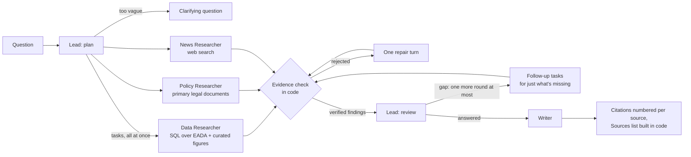

# Title IX Deep Research Agent

A research agent for **gender equity in college athletics**. Ask about participation, spending and
revenue at a school, conference or division, or how revenue sharing and NIL are changing them. It
answers from the federal Equity in Athletics (EADA) filings, primary legal documents (Title IX
regulations, the House v. NCAA settlement, NIL Go rules) and recent news, and every number in the
answer is checked against the query result or text it came from before you see it.

## Sample questions: this agent vs. Gemini + Google Search

Both systems got the same question. The baseline is Gemini 3.5 Flash with Google Search grounding.
The correct answers are computed from the EADA database (SQL in
[`evals/e2e_cases.jsonl`](evals/e2e_cases.jsonl)). Full answers:
[`docs/examples.md`](docs/examples.md). Only the most important errors are listed. The query-scope check and
broad-question mode described below came out of these comparisons. With the scope check, the end-to-end
evals went from 11/19 to 16/19, and from 5/8 to 7/8 on eight held-out questions written after the fix and
never used to tune it (`uv run evals/run_evals.py e2e`).

| Question | Correct answer | This agent | Gemini + Search |
|---|---|---|---|
| Is there a difference between coaching staff sizes between men's and women's college basketball? If so, is that difference statistically significant? | D-I schools with both teams, 2024-25 (n = 356): 5.24 coaches on the men's team vs. 4.87 on the women's. Small but significant (paired t ≈ 7.8). | **Right.** 5.24 vs. 4.85 in 2024-25, called significant, from per-team basketball rows. (Before the scope check it used department-wide coach counts.) | **Off target.** Says countable coaches show "no difference" because NCAA limits are equal; the actual counts differ. Its "statistically significant" is about budgets and support staff. |
| What percentage of Power 5 schools met Title IX's proportionality test in 2023-24, i.e. women's share of athletes was substantially proportionate to their share of undergraduates? | 27 of 69 schools (39.1%) were within 5 points; the median gap was 6.4 points. No legal cutoff exists, and proportionality is one prong of three. | **Wrong year.** Answered for 2022-23 (65 schools). Its correct 2023-24 finding (6, 10 and 17 of 69 within 1, 2 and 3 points) was rejected by a bug, since fixed, and the follow-up task named the wrong survey year, also fixed. | **Unchecked figure.** "8 of 65 (12.3%)", attributed to a Drake Group paper: 65 schools (the 2023-24 total was 69), cutoff never stated. |
| How do schools without large football programs still bring in enough revenue to compete in a post-NIL landscape? | Qualitative. Checked for: revenue sources, a correct revenue-sharing cap ($20.5M in 2025-26), and revenue sharing kept separate from NIL. | **Broad and cited** (broad-question mode). Media rights, donors and collectives, fractional revenue-sharing opt-ins, cuts to other sports, each with a source; EADA basketball revenue by classification. Misses student fees. | **Broad, unsourced figures.** Similar coverage; its dollar estimates (e.g. "$6–10M per Big East program") aren't tied to a source. Also misses student fees. |

Live at: **TODO URL** 

## Data

| Source | What | Loaded as |
|---|---|---|
| [EADA data files](https://ope.ed.gov/athletics/#/datafile/list), U.S. Dept. of Education | Participation, enrollment, coaching, spending and revenue by school, sport, gender and year; 2015-16 through 2024-25, 2,203 schools | `institutions` (20,353 school-years), `sports` (173,686 sponsored-sport rows), views `v_proportionality`, `v_spending_by_gender` |
| IPEDS institutional characteristics | Each school's conference by year, a power-conference flag | `conferences` |
| [`data/nil_facts.csv`](data/nil_facts.csv) | 13 curated NIL, revenue-sharing and settlement figures, each with its source, period, method note and whether it was checked against the primary source | `nil_facts` |
| [`data/policy/`](data/policy/) | 14 primary documents: Title IX statute and regulations, the 1979 interpretation and 1996 three-part test clarification, OCR NIL guidance and its rescission, the House v. NCAA settlement and final approval order, CSC / NIL Go rules, the EADA user's guide | searched by `policy.py` |
| Web (Tavily) | Recent news and reports | `web.py`, cached 24 h with retrieval time |

Column meanings, known pitfalls and the build decisions to clean and aggregate everything are logged in a fresh markdown in [`data/README.md`](data/README.md) and
[`data/column_notes.json`](data/column_notes.json).

## How it works



1. **Lead (plan)** reads the question and returns either a clarifying question or a task for every
   researcher that has part of the answer. They're sent at once and run in parallel, each in a fresh
   context that sees only its task.
2. **Data Researcher** writes SQL against a read-only DuckDB copy of EADA (2015-16 through 2024-25,
   2,203 schools) and a curated table of NIL, revenue-sharing and settlement figures. It sees only the
   part of the schema its task needs, plus the notes that prevent known wrong answers.
3. **Policy Researcher** searches 14 primary legal documents (Title IX regulations, the three-part
   test, the House v. NCAA settlement and the court's approval order, NIL Go rules, the EADA guide).
4. **News Researcher** searches and reads the web (Tavily) for what happened after the data and the
   documents. No paywall workarounds. When the Lead labels a question **broad** (how something is
   playing out across schools, not a number or a rule), two News Researchers take different angles,
   on the full model, with twice the search and page budget, and the Writer gets about 500 words
   instead of 250. Data questions run as before. Either way the Writer uses only verified findings,
   never its own knowledge.
5. **Evidence check** (`evidence.py`, plain code): a finding survives only if its quote is in what a
   tool returned this run and every number in its claim is in that quote or query result. For SQL
   findings it also checks the query itself: a model extracts each data task's scope (sports,
   conferences, divisions, years, schools) using the database's own values, and the query must filter
   on it. Numbers from the right table but the wrong sport or year are rejected. A researcher gets one
   turn to fix rejected findings; the fixes face the same check.
6. **Lead (review)** sees the verified findings, the gaps the researchers reported and what was
   rejected, and goes back for more when an important part is unanswered: follow-up tasks for just
   that part, naming what was already found. At most one more round (`MAX_ROUNDS = 2`). It stops when
   the findings answer the question or the gap is something no source has.
7. **Writer** sees only the question and the verified findings. It keeps the four kinds of money apart
   (school athletics spending, revenue sharing, third-party NIL, House back-pay damages), labels every
   number with its period, and ends with what the answer can't tell you.
8. **Citations** are numbered per source in reading order ([1], [2]...). On the page, hovering a
   citation shows the source, the exact evidence each claim rests on, and the SQL.

Limits per question, enforced in code: 2 research rounds, 10 turns and 8 SQL queries per researcher,
5 policy searches, 4 web searches. A follow-up question in the same conversation starts from the
findings already gathered instead of researching again.

- **Follow-ups** reuse the conversation's findings: the Lead researches only what they don't cover.
  *New topic* starts fresh.
- **Unanswerable questions** say so: individual athletes' NIL earnings aren't public; EADA can't show
  whether a school complies with Title IX (proportionality is one prong of three).
- **What the evidence check can't do:** it proves a number was copied faithfully from a query result
  or a page, and that the query filtered on the task's sport, conference, division, years and schools.
  It can't tell whether the query computed the right thing within that scope (all teams vs. only
  schools with both a men's and a women's team, say). That's what the gold-answer evals are for.

## Run it

```bash
cp .env.example .env                  # add VERTEXAI_PROJECT and TAVILY_API_KEY
gcloud auth application-default login
uv sync
uv run scripts/build_eada.py          # once, offline (raw files: data/README.md)
uv run app.py                         # http://localhost:8000
```

## Deploy (Cloud Run, from GitHub)

Every push to `main` builds with Google Cloud's buildpacks and deploys (entrypoint
`uvicorn app:app --host 0.0.0.0 --port $PORT`). The database isn't in the repo: it's read from a
Cloud Storage bucket mounted into the container.

1. Upload `data/eada.duckdb` to the **top level** of a bucket (public access prevented). Re-upload it
   after changing the build, `data/column_notes.json` or `data/nil_facts.csv`.
2. Put the Tavily key in Secret Manager as `tavily-api-key`: the key's value only, not the `.env` line.
3. In the service's *Containers, Volumes, Networking, Security*:

| Setting | Value |
|---|---|
| Volume | the bucket, **read-only**, mounted at `/data` |
| Env vars | `EADA_DB=/data/eada.duckdb` (leading `/`), `VERTEXAI_PROJECT=<project id>`, `CACHE_DIR=/tmp/cache` |
| Secret as env var | name `TAVILY_API_KEY`, secret `tavily-api-key`, version `latest` |
| Resources | 2 GiB memory, request timeout 900 s, max instances 1 (conversations live in memory) |
| Authentication | require authentication, IAP restricted to `columbia.edu` |

4. The service's runtime service account (the default compute account unless you pick another) needs
   **Secret Manager Secret Accessor** on the secret, **Storage Object Viewer** on the bucket and
   **Vertex AI User** on the project. A missing grant shows up as a failed deploy (secret) or an
   error on the first question (bucket, Vertex AI).

##  Root Repo Overview

```
app.py              FastAPI: the page, /run (live events), /chat (JSON), conversations
research.py         Lead (plan, review), Data, Policy and News Researchers, Writer; citations and source cards
evidence.py         the evidence check, chart check and citation check (stdlib, self-test)
eada.py             read-only DuckDB, the task-sized schema, the scope vocabulary (sports, conferences, divisions)
policy.py  web.py   policy corpus search; web search, fetch, paywall detection, cache
runlog.py           run traces and the per-agent scorecard
context_panel.py    context-panel.js   the course template's context panel (Film room tab)
static/             the page: index.html, playbook.js (the play diagram)
scripts/            offline: download_eada.py, build_eada.py
sql/                tables.sql (columns kept), views.sql (derived metrics)
data/               column_notes.json, nil_facts.csv, sources.json, policy/ (database and raw files: gitignored)
evals/              plan, scope, data and e2e cases (gold SQL, held-out set); run_evals.py, compare_baseline.py, scoring.py
```

